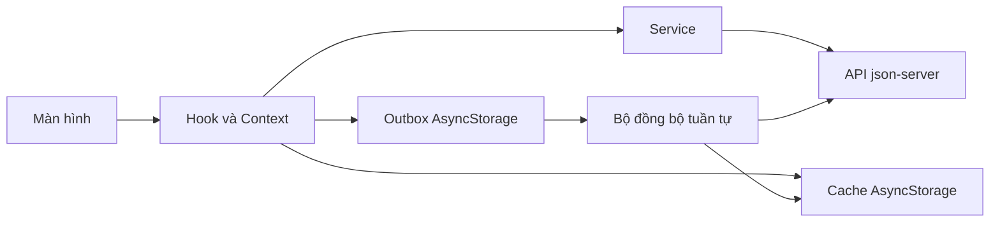

# Thực hành 4 Quản lý học tập với API và chế độ offline

Ứng dụng Expo có 5 tab: Tổng quan, Môn học, Thời khóa biểu, Bài tập và Cá nhân. Dữ liệu được chuyển từ bài Thực hành 3 của Nguyễn Quang Tuyến sang `db.json`, với ít nhất 5 bản ghi cho mỗi tài nguyên. Bài tập này chạy độc lập trong thư mục `StudyManager` để giữ nguyên dự án React Native CLI của bài trước.

## Cài đặt và chạy

Yêu cầu Node.js 22 trở lên và Expo Go hoặc Android emulator. Trong thư mục này:

```powershell
npm install
npm run api
```

Mở cửa sổ terminal thứ hai, cũng tại thư mục này:

```powershell
npm start
```

Nhấn `a` để chạy Android emulator hoặc quét QR bằng Expo Go. Script khởi động tự thêm thư mục `emulator` và `platform-tools` của Android SDK vào `PATH` của Expo; chạy `node scripts/start.cjs --check` để xem SDK và máy ảo được phát hiện. Nếu Expo đã chạy trước khi sửa script, nhấn Ctrl+C rồi chạy lại. Android emulator dùng `http://10.0.2.2:3000` theo mặc định. Nếu dùng điện thoại thật, sao chép `.env.example` thành `.env.local`, đổi `EXPO_PUBLIC_API_URL` thành `http://<IP-LAN-của-máy-tính>:3000`, bảo đảm cả hai cùng Wi-Fi và khởi động lại Expo. API có độ trễ giả lập 800 ms. Máy thật cần cho phép truy cập cổng 3000 qua tường lửa nếu bị chặn. Có thể chạy `npm run web` để xem giao diện trên máy tính; mặc định web dùng `http://localhost:3000`.

Nếu cổng 3000 đã được dùng, dừng dịch vụ kia hoặc sửa đồng thời lệnh `api` và `BASE_URL` trong `src/config.js` hoặc `.env.local`. Chạy `npm run check`, `npm test` và `npm run export:web` để kiểm tra cấu trúc, logic và khả năng đóng gói.

## Luồng dữ liệu



`useCachedQuery` đọc cache trước rồi GET khi có mạng. Mỗi GET thành công lưu `{data, savedAt}` bằng khóa `cache:<resource>`; cache cũ hơn TTL vẫn hiển thị khi offline. `AppDataContext` chia sẻ dữ liệu giữa các tab; thay đổi trạng thái bài tập được áp dụng ngay trên giao diện. Mọi thao tác chưa gửi được lưu bền vững thành `{id, method, url, body, createdAt}` trong `outbox`, hiển thị “Chưa đồng bộ”, rồi gửi đúng thứ tự khi có mạng. POST có ID do ứng dụng tạo để thử lại an toàn nếu đã gửi nhưng mất phản hồi. Lỗi HTTP khi thao tác trực tuyến sẽ hoàn tác cập nhật lạc quan; lỗi mạng hoặc timeout sẽ đưa thao tác vào hàng đợi. Nếu một thao tác đồng bộ lỗi, nó và các thao tác sau vẫn nằm trong hàng đợi và được thử lại khi mạng trở lại, ứng dụng được mở lại hoặc sau 15 giây.

### Xử lý xung đột

Trước mỗi thao tác trong outbox, ứng dụng GET bản ghi tương ứng. Nếu `updatedAt` trên máy chủ **mới hơn** `updatedAt` ghi cùng thao tác offline, ứng dụng bỏ thay đổi offline đó, dùng dữ liệu máy chủ, xóa thao tác khỏi hàng đợi và báo xung đột cho người dùng. Nếu không, ứng dụng gửi PATCH/POST. Thao tác đồng bộ thành công cập nhật cache trước khi xóa khỏi hàng đợi để tránh mất dữ liệu khi khởi động lại giữa chừng. Quy tắc này áp dụng cho hồ sơ sinh viên và bài tập; `updatedAt` của thao tác được tạo lúc người dùng bấm Lưu/đổi trạng thái.

## Kiểm tra 7 kịch bản và quay video 3–5 phút

1. Dừng `json-server`, mở ứng dụng lần đầu trên thiết bị chưa có cache: màn hình báo lỗi và nút **Thử lại**.
2. Chạy API, tải dữ liệu, bật chế độ máy bay rồi khởi động lại: 5 tab đọc cache, có banner offline và thời điểm cập nhật cuối.
3. Khi offline, đánh dấu xong hai bài tập và thêm một bài: danh sách đổi ngay, ba mục có nhãn **Chưa đồng bộ**.
4. Tắt chế độ máy bay: thấy thông báo số thay đổi đã đồng bộ, nhãn biến mất; kiểm tra `db.json`.
5. Khi offline, sửa họ tên. Trước khi bật mạng, sửa `students[0].fullName` và `students[0].updatedAt` trong `db.json` thành thời điểm mới hơn thao tác offline; bật mạng và quan sát thông báo xung đột cùng tên từ server.
6. Tìm môn học không có thật hoặc chọn bộ lọc không có kết quả: trạng thái rỗng thân thiện.
7. Kéo xuống ở danh sách Môn học, Thời khóa biểu, Bài tập và Kết quả học tập: dữ liệu tải lại.


